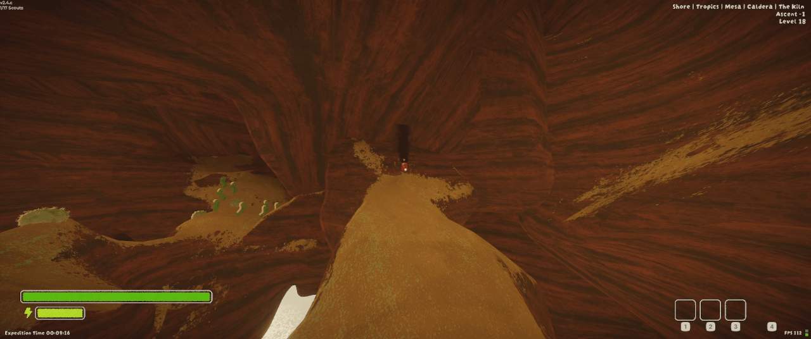
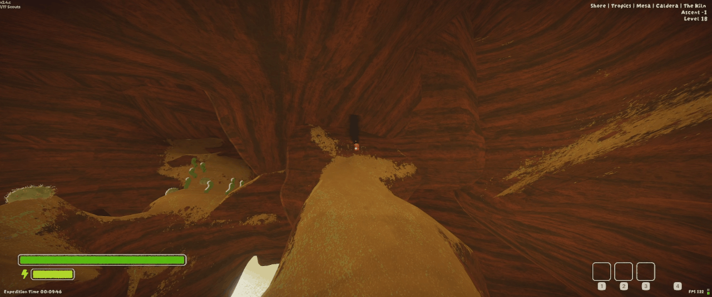

# NoScreenShake

Disables camera shake from all sources during gameplay. 
Dynamite explosions, magic bean eruptions, etc.. become less annoying in high traffic chaos lobbies.

## Showcase
### With Mod

### Without Mod

## Config

**The mod supports live on/off toggling through the bepinex config.**

- Disable Screen Shake: `ON/OFF`

## Links

Bug Reports/Support: https://rombusz.dev/contacts/bug-report/?mod=no-screen-shake  
Feature Requests: https://rombusz.dev/contacts/feature-request/?mod=no-screen-shake  
Questions: https://rombusz.dev/contacts/message/